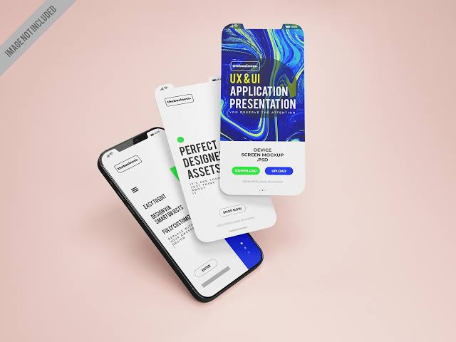

# Como editar este portfólio

Este repositório é um portfólio feito em HTML e CSS puros, publicado no
GitHub Pages. Este guia mostra como mudar o visual, as imagens, os
textos e os links, e como adicionar cases e experiências, para o site
ficar com a sua cara.

**Não precisa saber programar.** Na maior parte do tempo, você vai
trocar um valor ou um texto e salvar.

## Sumário

0. [Antes de tudo: os arquivos e como editar no GitHub](#0-antes-de-tudo)
1. [Mudar os estilos: cores, fontes, botões e cards](#1-mudar-os-estilos)
2. [Trocar as imagens](#2-trocar-as-imagens)
3. [Mudar os textos e os links](#3-mudar-os-textos-e-os-links)
4. [Adicionar um case](#4-adicionar-um-case)
5. [Adicionar experiência, formação e habilidades](#5-adicionar-experiência-formação-e-habilidades)
6. [Outros ajustes úteis](#6-outros-ajustes-úteis)
7. [Checklist: deixe com a sua cara](#7-checklist-deixe-com-a-sua-cara)
8. [Se algo der errado](#8-se-algo-der-errado)

---

## 0. Antes de tudo

### Os arquivos

```
index.html      página inicial (apresentação e cases)
sobre.html      página sobre (texto, foto, formação, experiência)
case-1.html     página de um case (um arquivo para cada case)
style.css       o visual do site inteiro (cores, fontes, tamanhos)
img/            todas as imagens
```

Todas as páginas usam o mesmo `style.css`. Mudou ali, muda no site
inteiro.

### Como editar um arquivo no GitHub

1. No repositório, clique no arquivo (ex.: `style.css`).
2. Clique no **lápis** (Edit this file), no canto superior direito.
3. Faça a mudança.
4. Clique em **Commit changes** e confirme.
5. Espere de 1 a 5 minutos e recarregue o site com **Ctrl + Shift + R**
   (no Mac, **Cmd + Shift + R**).

> **Dica:** dentro do editor, use **Ctrl + F** (Cmd + F) para achar um
> trecho. Neste guia, sempre que aparecer "procure por", é isso que você
> vai fazer.

### Os comentários do código

Os textos entre `<!--` e `-->` (no HTML) e entre `/*` e `*/` (no CSS)
são **comentários**: explicam o código e não aparecem no site. Eles vão
te guiar, por exemplo:

```html
<!-- CASE 1: copie daqui até FIM DO CASE 1 para adicionar outro -->
<!-- IMAGEM: troque o arquivo img/case-1-capa.jpg -->
```

---

## 1. Mudar os estilos

Quase todo o visual está concentrado em **variáveis**, no começo do
`style.css`, dentro do bloco `:root`. Uma variável é um valor com nome:
você muda o valor uma vez e ele muda em todos os lugares onde é usado.

```css
:root {
  --cor-fundo: #f0f1f3;
  --cor-texto: #1e1e1e;
  ...
}
```

### 1.1 Cores

No `style.css`, procure por `/* Cores */` e troque os códigos que
começam com `#`:

| Variável | O que muda |
| --- | --- |
| `--cor-fundo` | Fundo de todas as páginas |
| `--cor-fundo-imagem` | Bloco cinza que aparece enquanto a imagem não foi enviada |
| `--cor-texto` | Títulos e textos principais |
| `--cor-descricao` | Textos de apoio (descrição dos cases, parágrafos) |
| `--cor-menu` | Links do menu |
| `--cor-botao` | Fundo dos botões |
| `--cor-botao-texto` | Texto dos botões |
| `--cor-divisoria` | Linhas divisórias |
| `--cor-pilula-fundo` | Fundo das tags dos cases ("UX/UI Design") |
| `--cor-pilula-texto` | Texto das tags dos cases |

Exemplo, para um fundo creme e botão verde-escuro:

```css
--cor-fundo: #f7f3ec;
--cor-botao: #1f4d3a;
```

> **Contraste:** confira se o texto continua fácil de ler sobre o fundo
> no [WebAIM Contrast Checker](https://webaim.org/resources/contrastchecker/).
> O resultado precisa passar em **WCAG AA**.

### 1.2 Fontes

As fontes vêm do [Google Fonts](https://fonts.google.com) e mudam em
**dois lugares**:

**Passo 1: carregar a fonte nova nas páginas**

1. No Google Fonts, escolha a fonte dos títulos e a dos textos.
2. Clique em **Get font** e depois em **Get embed code**.
3. Copie só a linha que começa com
   `<link href="https://fonts.googleapis.com/css2?family=...`.
4. Em **cada arquivo HTML** (`index.html`, `sobre.html` e todos os
   `case-N.html`), procure por `fonts.googleapis.com/css2` e substitua
   essa linha pela que você copiou.

> Escolha os pesos **300, 400, 500 e 700** quando a fonte tiver, porque o
> site usa todos eles.

**Passo 2: dizer ao CSS qual fonte usar**

No `style.css`, procure por `/* Fontes */` e troque o nome entre aspas,
exatamente como aparece no Google Fonts:

```css
--fonte-titulo: "Playfair Display", system-ui, sans-serif;
--fonte-texto: "Inter", system-ui, sans-serif;
```

### 1.3 Tamanhos de texto

Ainda no `:root`, as variáveis que começam com `--tam-` são tamanhos, e
as que começam com `--peso-` são a grossura da letra (300 é fina, 700 é
negrito).

| Variável | O que muda |
| --- | --- |
| `--tam-titulo-principal` | Título grande da página inicial |
| `--tam-apresentacao` | Frase abaixo do título |
| `--tam-nome-case` | Nome do case nos cards |
| `--tam-descricao` | Descrição dos cards e textos de apoio |
| `--tam-menu` | Links do menu |
| `--tam-email` | E-mail grande do rodapé |

> **Importante: o celular tem os próprios tamanhos.** O `style.css`
> repete algumas variáveis dentro de blocos que começam com
> `@media (max-width: 720px)`. Eles valem só para telas pequenas. Se
> você mudar um tamanho e ele não mudar no celular, procure por
> `@media (max-width: 720px)` e ajuste a mesma variável lá. Existem três
> blocos desses: um geral, um da página Sobre e um da página de case.

As páginas Sobre e Case têm variáveis próprias, mais embaixo no
arquivo. Procure por `/* ---------- Variáveis novas da página Sobre` e
`/* ---------- Variáveis novas da página de case`.

### 1.4 Formato dos botões

No `style.css`, procure por `.botao {`:

```css
.botao {
  padding: 14px 28px;     /* tamanho: altura e largura internas */
  border-radius: 999px;   /* formato: 999px é pílula */
  font-size: 16px;
  ...
}
```

| Para deixar o botão... | Troque `border-radius` por |
| --- | --- |
| Pílula (atual) | `999px` |
| Com cantos arredondados | `8px` |
| Reto | `0` |

Para um botão **só com contorno** (sem fundo, que se preenche ao passar
o mouse), cole no fim do `style.css`:

```css
/* Botão só com contorno */
.botao {
  background: transparent;
  border: 2px solid var(--cor-botao);
  color: var(--cor-botao);
}

.botao:hover {
  background: var(--cor-botao);
  color: var(--cor-botao-texto);
}
```

O efeito ao passar o mouse do botão normal fica em `.botao:hover {`.
Hoje, o fundo escurece e o botão sobe 2px.

### 1.5 Formato dos cards e das imagens

**Cantos arredondados só nas imagens dos cards:** cole no fim do
`style.css`:

```css
/* Cards com cantos arredondados */
.card .imagem {
  border-radius: 16px;
}
```

**Cantos arredondados em todas as imagens do site** (cards, foto e
imagens dos cases): procure por `.imagem {` e acrescente a linha
`border-radius: 16px;` dentro dela.

**Mudar a proporção da imagem do card** (de quadrada para horizontal):
cole no fim do `style.css`:

```css
/* Imagem do card horizontal */
.card .imagem {
  aspect-ratio: 4 / 3;
}
```

Proporções comuns: `1 / 1` (quadrada), `4 / 3`, `3 / 2` e `16 / 9`
(mais horizontal).

**Card com fundo, como uma caixa:** cole no fim do `style.css`:

```css
/* Card com fundo branco e borda arredondada */
.card {
  padding: 16px;
  background: #ffffff;
  border-radius: 20px;
}
```

**Tags dos cases (pílulas):** para deixar quadradas, procure por
`.pilulas li {` e troque `border-radius: 999px;` por `border-radius: 4px;`.

**Espaço entre os cards:** mude a variável `--espaco-cards` no `:root`.

**Largura do site:** mude `--largura-max` (hoje 1028px).

---

## 2. Trocar as imagens

Todas as imagens ficam na pasta `img`, e cada uma tem um nome fixo.
Enquanto o arquivo não existir, aparece um **bloco cinza** no lugar.

| Imagem | Nome do arquivo | Formato |
| --- | --- | --- |
| Sua foto (página Sobre) | `img/perfil.jpg` | quadrada (ex.: 800 × 800 px) |
| Capa do case 1 (página inicial) | `img/case-1-capa.jpg` | quadrada (ex.: 1000 × 1000 px) |
| Imagem do topo do case 1 | `img/case-1-topo.jpg` | 3:2 (ex.: 1500 × 1000 px) |
| Imagens dentro do case 1 | `img/case-1-imagem-1.jpg`, `img/case-1-imagem-2.jpg`... | 16:9 (ex.: 1920 × 1080 px) |
| Case 2, 3... | igual, trocando o número: `img/case-2-capa.jpg`... | |

### Para trocar uma imagem

1. Salve a sua imagem com **exatamente o mesmo nome** (ex.:
   `case-1-capa.jpg`).
2. No repositório, clique na pasta **`img`**.
3. Clique em **Add file** e depois em **Upload files**.
4. Arraste a imagem e clique em **Commit changes**. Se já existia uma
   com esse nome, ela é substituída.

Não precisa mexer no código.

### Cuidados

- Use **.jpg**. No Figma, exporte como JPG.
- Nome **sem acento, sem espaço e em minúsculas**: `case-1-capa.jpg`
  funciona, `Case 1 Capa.JPG` não funciona.
- Deixe cada imagem com menos de 500 KB. O [Squoosh](https://squoosh.app)
  reduz o peso sem perder qualidade.
- A imagem é cortada para caber no formato, sem distorcer. Deixe o mais
  importante no centro.

### Texto alternativo (alt)

Cada imagem tem um `alt` no código, que descreve a imagem para quem usa
leitor de tela:

```html

```

Quando trocar a imagem, troque também o texto do `alt` para descrever o
que aparece nela.

### Usar uma imagem com outro nome

Se preferir outro nome (ex.: `tela-inicial.jpg`), suba a imagem na
pasta `img` e troque o caminho no `src` do HTML. Procure pelo
comentário `<!-- IMAGEM:` acima de cada imagem.

---

## 3. Mudar os textos e os links

### A regra de ouro

Mude só o texto que fica **entre `>` e `<`**:

```html
<h1>Oie, me chamo Vanessa.</h1>
```

vira

```html
<h1>Oi, eu sou a Ana.</h1>
```

Não apague os sinais `<` `>` nem o que está dentro deles. Para deixar
uma palavra em **negrito**, coloque entre `<strong>` e `</strong>`.

### Onde está cada texto

| Texto | Arquivo | Procure por |
| --- | --- | --- |
| Título que aparece na aba do navegador | todos os HTML | `<title>` |
| Iniciais do logo (V.) | todos os HTML | `class="logo"` |
| Título grande da página inicial | `index.html` | `<h1>` |
| Frase abaixo do título | `index.html` | `class="apresentacao"` |
| Nome, tags e descrição de cada case | `index.html` | `CASE 1`, `CASE 2`... |
| Texto da página Sobre | `sobre.html` | `<h1>Sobre mim</h1>` |
| Formação, experiência e habilidades | `sobre.html` | `FORMAÇÃO 1`, `EXPERIÊNCIA 1`, `HABILIDADE 1` |
| Conteúdo de um case | `case-1.html` | `BLOCO 1`, `BLOCO 2`... |
| Papel, equipe e tempo do case | `case-1.html` | `INFO 1`, `INFO 2`... |
| Números de resultado | `case-1.html` | `RESULTADO 1`... |
| Frase acima do e-mail no rodapé | todos os HTML | `contato-chamada` |

### Links

Os links ficam no atributo `href`. Troque só o que está entre as aspas:

```html
<a href="https://www.linkedin.com/in/seu-perfil">LinkedIn</a>
```

O menu e o rodapé **se repetem em todas as páginas**. Por isso, cada
link precisa ser trocado em todos os arquivos HTML:

| Link | Onde aparece | Procure por |
| --- | --- | --- |
| LinkedIn | menu do topo e botão do rodapé (2 vezes por página) | `linkedin.com` |
| Currículo | menu do topo e menu do rodapé (2 vezes por página; 3 na Sobre, por causa do botão) | `drive.google.com` |
| E-mail | rodapé (2 vezes por página: no link e no texto que aparece) | `mailto:` |

O link do e-mail precisa manter o `mailto:` na frente:

```html
<a class="contato-email" href="mailto:seuemail@exemplo.com">seuemail@exemplo.com</a>
```

> **Currículo no Google Drive:** no Drive, abra o arquivo, clique em
> **Compartilhar** e mude o acesso para **Qualquer pessoa com o link**.
> Se não fizer isso, quem clicar vai cair numa tela de "pedir acesso".

---

## 4. Adicionar um case

Um case novo envolve três coisas: a **página** do case, o **card** na
página inicial e as **imagens**. O exemplo abaixo cria o case 3; troque
pelo número que você precisar.

### 4.1 Criar a página do case

1. No repositório, abra o `case-1.html`.
2. Clique no botão **Copy raw file** (o ícone de dois quadradinhos, no
   canto superior direito do código).
3. Volte para a página inicial do repositório e clique em **Add file**
   e depois em **Create new file**.
4. No nome, escreva `case-3.html`.
5. Cole o código copiado.
6. Troque `case-1` por `case-3` nos nomes das imagens. Procure por
   `img/case-1` e troque cada um:
   `img/case-1-topo.jpg` → `img/case-3-topo.jpg`, e assim por diante.
7. Troque os textos: nome do projeto, `<title>`, informações, blocos e
   resultados.
8. Clique em **Commit changes**.

### 4.2 Colocar o card na página inicial

1. Abra o `index.html` e clique no lápis.
2. Procure por `<!-- CASE 1:`.
3. Selecione tudo, desse comentário até `<!-- FIM DO CASE 1 -->`
   (inclusive), e copie.
4. Cole logo depois do último `<!-- FIM DO CASE ... -->`.
5. No trecho colado, troque:
   - o número nos comentários (`CASE 1` → `CASE 3`);
   - o link: `href="case-1.html"` → `href="case-3.html"`;
   - a imagem: `img/case-1-capa.jpg` → `img/case-3-capa.jpg`;
   - o `alt`, o nome, as tags e a descrição.
6. Clique em **Commit changes**.

### 4.3 Subir as imagens

Na pasta `img`, suba `case-3-capa.jpg`, `case-3-topo.jpg`,
`case-3-imagem-1.jpg`... (veja o item 2).

### 4.4 Atualizar "Veja outros cases" (opcional)

No fim de cada página de case existe a seção **Veja outros cases**.
Para o case novo aparecer nela, abra cada `case-N.html`, procure por
`<!-- OUTRO CASE 1:`, copie até `<!-- FIM DO OUTRO CASE 1 -->`, cole
embaixo e troque o link, a imagem e o nome.

> No exemplo deste repositório, o card do **Case 2** já está na página
> inicial, mas o arquivo `case-2.html` ainda não existe. Clicar nele dá
> erro até você criar a página, seguindo o passo 4.1.

### Remover um case

1. No `index.html`, apague o trecho do `<!-- CASE N:` até o
   `<!-- FIM DO CASE N -->`.
2. Apague o card dele em "Veja outros cases" das outras páginas.
3. Apague o arquivo `case-N.html` e as imagens dele (abra o arquivo,
   clique nos **três pontinhos** e depois em **Delete file**).

---

## 5. Adicionar experiência, formação e habilidades

Tudo fica no `sobre.html` e segue o mesmo modelo.

### Nova experiência

1. Abra o `sobre.html` e clique no lápis.
2. Procure por `<!-- EXPERIÊNCIA 1:`.
3. Copie do comentário até `<!-- FIM DA EXPERIÊNCIA 1 -->`, inclusive.
4. Cole logo depois do último `<!-- FIM DA EXPERIÊNCIA ... -->`.
5. Troque o número nos comentários, o nome da empresa (no `<h3>`) e o
   cargo e período (no `<li>`).
6. Clique em **Commit changes**.

O trecho copiado é este:

```html
<!-- EXPERIÊNCIA 1: copie daqui até FIM DA EXPERIÊNCIA 1 para adicionar outra -->
<div class="item">
  <h3>Nome da empresa</h3>
  <ul>
    <li>Cargo • mês/ano – atual</li>
  </ul>
</div>
<!-- FIM DA EXPERIÊNCIA 1 -->
```

### Mais de um cargo na mesma empresa

Dentro do `<ul>` da empresa, copie a linha do `<li>` e cole embaixo:

```html
<ul>
  <li>Product Designer • 2024 – atual</li>
  <li>UX/UI Designer • 2022 – 2024</li>
</ul>
```

### Nova formação ou habilidade

Mesmo processo. Procure por `<!-- FORMAÇÃO 1:` ou `<!-- HABILIDADE 1:`,
copie até o comentário de fim, cole embaixo e troque os textos.

> A experiência mais recente costuma vir primeiro. Para mudar a ordem,
> recorte um bloco inteiro (do comentário de início ao de fim) e cole na
> posição que quiser.

---

## 6. Outros ajustes úteis

### Tags dos cases (pílulas)

No `index.html`, dentro de cada case, as tags ficam numa lista:

```html
<ul class="pilulas">
  <li>UX/UI Design</li>
  <li>Mobile First</li>
</ul>
```

Para adicionar uma tag, copie uma linha `<li>` e cole embaixo. Para
remover todas as tags de um case, apague o `<ul class="pilulas">`
inteiro, até o `</ul>`.

### Blocos da página de case

No `case-1.html`, cada bloco tem título, texto e imagem. O arquivo traz
três modelos para você copiar:

| Quero um bloco... | Copie o modelo |
| --- | --- |
| com uma imagem | `BLOCO 1` |
| com duas imagens lado a lado | `BLOCO 3` |
| só com texto | `BLOCO 1` e apague do `<figure>` até o `</figure>` |

- Para tirar a **legenda** de uma imagem, apague a linha do
  `<figcaption>`.
- Para **mudar a ordem**, recorte o bloco inteiro (do comentário de
  início ao de fim) e cole na posição desejada.
- Lembre de trocar o número da imagem em cada bloco
  (`case-1-imagem-1.jpg`, `case-1-imagem-2.jpg`...).

### Resultados

- Para adicionar um número, copie do `<!-- RESULTADO 1:` até
  `<!-- FIM DO RESULTADO 1 -->` e cole embaixo.
- Se o projeto não tiver números, apague a seção inteira: do
  comentário `RESULTADOS` até o `</section>` dela.

### Informações do case (Papel, Equipe, Tempo)

Copie do `<!-- INFO 1:` até `<!-- FIM DA INFO 1 -->` para adicionar
outra (ex.: "Ferramentas"). O título fica no `<dt>` e o conteúdo no
`<dd>`.

### Descrição para o Google

No topo de cada HTML, a linha `<meta name="description" ...>` é o texto
que aparece na busca do Google e quando o link é compartilhado. Troque o
que está dentro de `content="..."`.

### Trocar o mesmo texto em todos os arquivos de uma vez

Para trocar e-mail, LinkedIn ou currículo em todas as páginas juntas:

1. Na página do repositório, aperte a tecla **`.`** (ponto). Abre um
   editor completo no navegador.
2. Aperte **Ctrl + Shift + H** (Cmd + Shift + H) e escreva o texto
   antigo e o novo.
3. Clique em **Replace All**.
4. No ícone de ramificação da barra lateral (**Source Control**),
   escreva uma mensagem e clique em **Commit & Push**.

---

## 7. Checklist: deixe com a sua cara

- [ ] Troquei as iniciais do logo e o `<title>` de todas as páginas
- [ ] Escolhi minhas cores e conferi o contraste
- [ ] Escolhi minhas fontes (nos HTML e no `style.css`)
- [ ] Escrevi uma apresentação com a minha voz
- [ ] Coloquei minha foto e as capas dos meus cases
- [ ] Os cases são meus, com o meu papel e as minhas decisões
- [ ] Troquei e-mail, LinkedIn e currículo em todas as páginas
- [ ] O currículo no Drive está como "Qualquer pessoa com o link"
- [ ] Testei no celular (abri o link no celular ou diminuí a janela)
- [ ] Todos os links do menu e dos cards abrem a página certa

---

## 8. Se algo der errado

| O que aconteceu | O que fazer |
| --- | --- |
| Mudei e o site não atualizou | Espere alguns minutos e recarregue com Ctrl + Shift + R (Cmd + Shift + R no Mac). |
| A página ficou "crua" (fonte padrão, links azuis) | Confira se o `style.css` está na raiz, com esse nome exato, e se a linha `<link rel="stylesheet" href="style.css">` continua no HTML. |
| Uma parte perdeu o estilo depois de uma edição | Provavelmente uma tag ficou sem fechar ou uma `class` foi apagada. Volte a versão: abra o arquivo, clique em **History**, abra a versão anterior e copie o código dela. |
| Uma imagem continua cinza | O arquivo não está na pasta `img` ou o nome está diferente. Compare letra por letra, inclusive o `.jpg`. |
| O link de um case dá erro 404 | O arquivo precisa estar na raiz, com o nome `case-1.html`, `case-2.html`... igual ao `href` do card. |
| Mudei um tamanho e no celular continua igual | Ajuste também a variável dentro do bloco `@media (max-width: 720px)` (veja o item 1.3). |
| A fonte nova não apareceu | Confira se trocou a linha do Google Fonts em todos os HTML e se o nome no `style.css` está escrito igual ao do Google Fonts. |
| O currículo pede acesso | No Google Drive, mude o compartilhamento para "Qualquer pessoa com o link". |

> **Dica:** o GitHub guarda todas as versões de todos os arquivos. Se
> algo quebrar, sempre dá para voltar pelo **History**.
